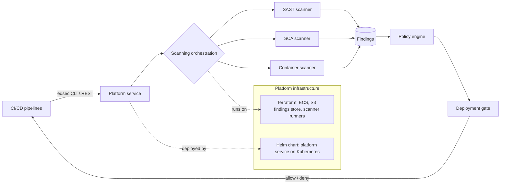

# enterprise-devsecops

Enterprise DevSecOps platform: centralized security policy management,
scanning orchestration across teams and repositories, and deployment
gating — with Terraform and Helm to run it.

[](LICENSE)
[](https://github.com/abhisheksawant52/enterprise-devsecops/actions/workflows/ci.yml)
[](https://www.python.org/)
[](https://github.com/psf/black)
[](https://www.terraform.io/)
[](https://helm.sh/)

## Overview

Security teams at scale need one place to define policy, one place scan
results land, and one gate that deployments actually respect — instead of
every team wiring its own SAST/SCA/container scanning and inventing its
own pass/fail rules. `enterprise-devsecops` provides that shared layer:
teams call it from CI, findings are evaluated against a single
organization policy, and a deployment either passes the gate or it
doesn't.

It targets platform security and DevSecOps engineering teams who own the
"you shall not deploy with a critical, unwaived finding" contract across
many repositories, and who need that contract enforced consistently
rather than reimplemented per project.

The repository ships the orchestration service and CLI, plus the
Terraform and Helm needed to run the platform itself.

## Architecture



Components:

- **Platform service** — FastAPI orchestration service exposing
  `/health`, `/ready`, `/scan`, and `/gate`.
- **Scanning orchestration** — pluggable `Scanner` implementations
  (SAST, SCA, container) behind a common registry.
- **Policy engine** — evaluates findings against an org security policy
  (severity thresholds, denied licenses, waivers).
- **Deployment gate** — turns policy evaluation into a single allow/deny
  decision consumable by CI/CD.
- **Terraform** — provisions the platform's own AWS infrastructure,
  including a scanner-runner compute fleet.
- **Helm chart** — deploys the platform service to Kubernetes.

See [docs/architecture.md](docs/architecture.md) for the full request flow.

## Features

- Central policy-as-code: severity thresholds, denied licenses, and
  per-finding/per-rule waivers in one YAML document.
- Scan orchestration across SAST, SCA, and container scanning with a
  pluggable scanner registry — add a new scanner without touching the
  service or CLI.
- Deployment gate that CI/CD pipelines can call directly; exits non-zero
  on denial for trivial pipeline integration.
- `edsec` CLI (`scan`, `policy`, `gate` subcommands) alongside a REST API
  for programmatic integration.
- Terraform module for scanner-runner compute that scales independently
  of the orchestration service.
- Helm chart with autoscaling, non-root security context, and optional
  ingress for the orchestration service.

## Tech Stack

Python 3.11+ · FastAPI · Click · Pydantic / pydantic-settings · PyYAML ·
Terraform (AWS) · Helm · Docker · GitHub Actions

## Getting Started

### Prerequisites

- Python 3.11 or newer
- `make` (optional, for convenience targets)
- Terraform >= 1.5 and Helm 3 (only needed for the infrastructure assets)

### Install

```bash
python -m venv .venv && source .venv/bin/activate
make install            # pip install -e .[dev]
cp .env.example .env
```

### Run the platform service

```bash
make run                # uvicorn enterprise_devsecops.service:app --reload
curl localhost:8080/health
```

### Use the CLI

```bash
edsec scan run . --type sast --type sca
edsec policy show
edsec gate evaluate . --policy-path policies/org-policy.yaml
```

## Project Structure

```
.
├── src/enterprise_devsecops/   # platform package
│   ├── service.py              # FastAPI orchestration service
│   ├── cli.py                  # edsec Click CLI
│   ├── policy.py                # policy engine
│   ├── gate.py                  # deployment gate
│   ├── models.py                # Policy, Finding, ScanRequest, GateDecision
│   └── scanning/                # SAST / SCA / container scanner modules
├── policies/org-policy.yaml    # example organization policy
├── terraform/                  # platform infrastructure (AWS)
│   ├── modules/scanner-runners/
│   └── environments/{dev,prod}/
├── helm/                       # Helm chart for the platform service
│   └── templates/
├── docs/architecture.md        # architecture and request flow
├── tests/                      # pytest suite
├── Dockerfile
└── .github/workflows/ci.yml    # this project's own pipeline
```

## Configuration

Copy [`.env.example`](.env.example) to `.env` and adjust as needed. All
variables are prefixed `EDSEC_`.

| Variable                        | Default                        | Description                                    |
| -------------------------------- | ------------------------------- | ----------------------------------------------- |
| `EDSEC_ENVIRONMENT`             | `development`                  | Deployment environment name.                    |
| `EDSEC_LOG_LEVEL`                | `INFO`                          | Python logging level.                           |
| `EDSEC_LOG_JSON`                 | `false`                         | Emit structured JSON logs.                      |
| `EDSEC_HOST` / `EDSEC_PORT`      | `0.0.0.0` / `8080`              | HTTP bind address for the platform service.     |
| `EDSEC_POLICY_PATH`             | `policies/org-policy.yaml`     | Path to the organization security policy.       |
| `EDSEC_DEFAULT_FAIL_ON`         | `HIGH`                          | Minimum severity that fails a gate by default.  |
| `EDSEC_SCAN_REPORT_BUCKET`      | _(empty)_                      | Bucket where scan reports are archived.         |
| `EDSEC_SCANNER_TIMEOUT_SECONDS` | `900`                           | Max time allotted to a single scanner run.      |

## Deployment

- **Kubernetes**: install the chart under [`helm/`](helm) —
  `helm install edsec ./helm -f my-values.yaml`. Includes a
  `HorizontalPodAutoscaler`, non-root `securityContext`, and optional
  `Ingress`.
- **AWS infrastructure**: the [`terraform/`](terraform) root module
  provisions the findings S3 bucket, ECS cluster, and scanner-runner
  fleet. Select an environment with
  `terraform apply -var-file=environments/dev/terraform.tfvars`.
- **Container image**: build with the multi-stage, non-root
  [`Dockerfile`](Dockerfile) — `make docker-build`.

## Contributing

Contributions are welcome — see [CONTRIBUTING.md](CONTRIBUTING.md) and our
[Code of Conduct](CODE_OF_CONDUCT.md).

## Security

Please report vulnerabilities as described in [SECURITY.md](SECURITY.md).

## License

Released under the [MIT License](LICENSE).
