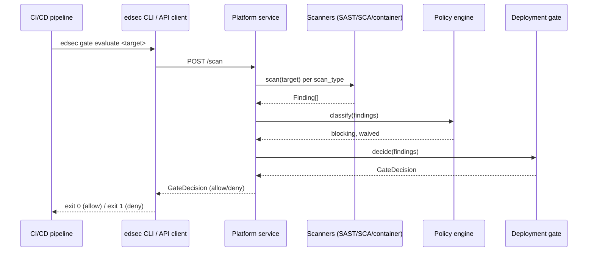

# Architecture

## Overview

`enterprise-devsecops` centralizes three concerns that are otherwise
scattered across teams: security policy definition, scan orchestration
across many repositories, and deployment gating. Teams call the platform
service (directly or via the `edsec` CLI in their CI pipelines) instead of
each maintaining their own scanner wiring and pass/fail logic.

## Components

- **Platform service** (`src/enterprise_devsecops/service.py`) — FastAPI
  application exposing `/health`, `/ready`, `/scan`, and `/gate`. Stateless;
  horizontally scaled behind the Helm-deployed Kubernetes Service.
- **Scanning orchestration** (`src/enterprise_devsecops/scanning/`) —
  pluggable `Scanner` implementations (SAST, SCA, container). The registry
  in `scanning/__init__.py` maps a scan type name to its implementation so
  new scanners can be added without touching the service or CLI.
- **Policy engine** (`src/enterprise_devsecops/policy.py`) — loads an
  organization `Policy` document (YAML) and classifies findings as
  blocking or waived.
- **Deployment gate** (`src/enterprise_devsecops/gate.py`) — combines scan
  findings with the policy engine to produce a single `GateDecision` that
  CI/CD pipelines key their pass/fail on.
- **Scanner runner infrastructure** (`terraform/modules/scanner-runners/`)
  — an Auto Scaling Group of compute nodes that execute scan jobs, sized
  independently of the platform service so scan throughput scales with the
  number of onboarded repositories.

## Request flow

## Infrastructure

- **Terraform** (`terraform/`) provisions the platform's own AWS
  infrastructure: an S3 bucket for archived findings, an ECS cluster for
  the orchestration service, and the `scanner-runners` module for scan
  compute. `environments/dev` and `environments/prod` hold per-environment
  tfvars.
- **Helm** (`helm/`) deploys the platform service container to Kubernetes,
  with `HorizontalPodAutoscaler`, `ServiceAccount`, and optional `Ingress`
  templates.

## Design notes

- Scanners are structured stubs: each documents the real subprocess
  invocation (e.g. Semgrep, `osv-scanner`, Trivy) it would perform, so the
  package has no hard dependency on any single scanner binary being
  installed. Wiring a real tool in is a deployment-specific concern.
- Policy waivers are matched against both `Finding.id` and `Finding.rule_id`
  so a waiver can target either a specific finding instance or an entire
  rule class.
